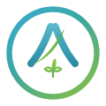

# Alvacea — Deodorant Spray Tawas Alami

> E-commerce + forum komunitas untuk deodorant spray tawas alami yang bisa diracik sendiri.
> Dibangun sebagai situs statis: tanpa framework, tanpa build step, tanpa dependensi.


---

## Tentang

Alvacea adalah konsep brand *green cosmetics* asal Bandung yang menjual deodorant spray berbahan tawas (alum) alami. Situs ini terdiri dari tiga halaman utama:

| Halaman | Fungsi |
| --- | --- |
| **Beranda** | Memperkenalkan produk, manfaat, perbandingan, racikan favorit, ulasan, dan FAQ |
| **Custom Produk** | Konfigurator interaktif: pilih basis, ekstrak herbal, aroma, dan botol dengan harga langsung terupdate |
| **Forum** | Komunitas co-creation: review, tips, ide produk, dan tanya jawab |

Semua ilustrasi (botol, daun, ikon) digambar manual sebagai inline SVG — tidak ada stock photo maupun gambar hasil AI.

<!-- Ganti dengan screenshot asli setelah kamu upload ke repo:


-->

---

## Fitur

### Beranda
- Hero dengan ilustrasi botol SVG, animasi float, dan blob organik
- Strip marquee benefit (hemat, aman kulit sensitif, anti noda kuning, refillable)
- 4 kartu manfaat dengan ikon berwarna dan nomor urut
- Tabel perbandingan **Alvacea vs deodoran biasa** (6 aspek)
- Alur 3 langkah "Cara Kerja" dengan garis penghubung
- 3 kartu ekstrak herbal
- **Racikan favorit** — 3 preset produk lengkap dengan harga
- Band statistik gelap (12.400+ botol, rating 4,9, dll.)
- Ulasan pelanggan + ringkasan rating + strip media
- **FAQ accordion** interaktif

### Custom Produk
- **Step rail sticky** yang menandai langkah mana yang sudah diisi
- 4 grup opsi: basis (single), ekstrak (multi-select), aroma (single), botol (single)
- Opsi "Tanpa ekstrak" yang otomatis membatalkan pilihan lain
- Slider intensitas aroma dengan label dinamis (Sangat Ringan → Sangat Kuat)
- Panel ringkasan sticky: nama racikan, rincian, total harga real-time, progress 4/4
- **Preview botol berubah warna** mengikuti ekstrak yang dipilih
- Toast konfirmasi saat menambahkan ke keranjang

### Forum
- Kartu unggulan "Ide komunitas → sudah jadi produk"
- Composer untuk membuat topik baru (langsung muncul di urutan teratas)
- Filter kategori (Semua / Review / Tips / Ide / Tanya Jawab)
- Kartu topik dengan aksen warna per kategori, avatar, dan statistik
- Sidebar: kategori, topik terpopuler, anggota aktif, dan CTA co-creation
- Empty state saat filter tidak menghasilkan topik

### Login
- Halaman login dua panel: panel brand gelap + form di sisi kanan
- Validasi username/password dengan pesan error yang jelas
- Toggle **Lihat / Sembunyi** pada field password
- Opsi **Ingat saya** (localStorage) atau sesi sementara (sessionStorage)
- Tombol **Isi otomatis** untuk mengisi akun demo
- Status "sudah masuk" dengan tombol keluar
- Header menampilkan chip akun + tombol keluar di semua halaman

### Umum
- Desain responsif (desktop → tablet → mobile)
- Animasi scroll reveal dengan `IntersectionObserver`
- Menghormati `prefers-reduced-motion`
- Navigasi mobile dengan menu hamburger
- Header sticky dengan efek blur

---

## Palet & Tipografi

| Warna | Hex | Penggunaan |
| --- | --- | --- |
| Shell |  | Latar utama |
| Stone |  | Garis, elemen netral |
| Sky |  | Aksen dingin |
| Honeydew |  | Aksen hangat |
| Viridian |  | Warna brand utama |

- **Display / heading:** [Fraunces](https://fonts.google.com/specimen/Fraunces)
- **Body / UI:** [Plus Jakarta Sans](https://fonts.google.com/specimen/Plus+Jakarta+Sans)

Keduanya dimuat dari Google Fonts.

---

## Struktur Proyek

```
ALVACEA/
├── index.html          # Beranda
├── custom.html         # Halaman kustomisasi produk
├── forum.html          # Forum komunitas
├── login.html          # Halaman masuk (demo)
├── assets/
│   ├── logo-mark.svg   # Logo (mark) — dipakai di header, footer, favicon
│   └── produk.png      # Foto produk untuk section "Bahan & proses"
├── css/
│   └── style.css       # Semua styling + design token
└── js/
    ├── auth.js         # Sesi login demo + render chip akun di header
    ├── main.js         # Header, nav mobile, scroll reveal, newsletter, FAQ
    ├── custom.js       # State pilihan, kalkulasi harga, ringkasan, step rail
    └── forum.js        # Filter kategori & pembuatan topik
```

---

## Akun Demo

Halaman login ada di `login.html`. Kredensial bawaan:

| Field | Nilai |
| --- | --- |
| Username | `charlene` |
| Password | `tawas2026` |

**Cara kerja:** sesi disimpan di `localStorage` (atau `sessionStorage` bila "Ingat saya" dimatikan). Header di semua halaman membaca sesi tersebut dan menampilkan chip akun + tombol keluar.

> ⚠️ **Ini autentikasi demo, bukan produksi.** Akun ditulis langsung di `js/auth.js` sehingga siapa pun yang membuka DevTools bisa membacanya. Untuk produksi, ganti dengan backend (mis. Supabase Auth, Auth0, atau API sendiri) dan jangan pernah menyimpan password di sisi klien.

Menambah akun demo — edit array `ACCOUNTS` di `js/auth.js`:

```js
var ACCOUNTS = [
  { username: 'charlene', password: 'tawas2026', name: 'Charlene' },
  { username: 'budi',    password: 'rahasia123', name: 'Budi' }
];
```

---

## Menjalankan

**Cara tercepat:** buka `index.html` langsung di browser.

**Disarankan (agar path relatif & font berjalan normal):**

```bash
# Python 3
python -m http.server 8099

# atau Node.js
npx serve .
```

Lalu buka <http://localhost:8099>.

### Deploy ke GitHub Pages

1. Push repo ini ke GitHub.
2. Buka **Settings → Pages**.
3. Pilih **Source: Deploy from a branch**, branch `main`, folder `/ (root)`.
4. Simpan — situs akan tersedia di `https://<username>.github.io/<repo>/`.

---

## Kustomisasi

**Ubah warna** — cukup edit variabel di bagian atas `css/style.css`:

```css
:root {
  --shell:    #F7F5F1;
  --stone:    #E0DCD1;
  --sky:      #D5E3E8;
  --honeydew: #E4E3BC;
  --viridian: #344945;
}
```

**Ubah harga dasar** — di `js/custom.js`:

```js
const BASE_PRICE = 49000;
```

**Ubah harga per opsi** — atribut `data-price` pada tombol opsi di `custom.html`:

```html
<button class="option" data-value="Daun Mint" data-price="5000">
```

**Ganti logo** — timpa file `assets/logo-mark.svg` dengan logomu (format SVG, disarankan rasio 1:1), atau ubah `src` pada elemen berikut di ketiga halaman:

```html

```

Warna wordmark "ALVACEA" diatur lewat token `--navy` di `css/style.css`.

**Ganti foto produk** — timpa `assets/produk.png` (disarankan rasio 4:3, sisi terpanjang ±1400 px). Selama file belum ada, section menampilkan placeholder otomatis, jadi halaman tidak pernah terlihat rusak.

Rincian harga saat ini:

| Komponen | Tambahan |
| --- | --- |
| Basis Tawas Murni | Rp0 |
| Basis Tawas + Aloe Vera | +Rp6.000 |
| Ekstrak (per pilihan) | +Rp5.000 |
| Aroma Mint Segar / Herbal Campur | +Rp4.000 |
| Botol 60 ml | +Rp3.000 |
| Paket 2 Botol | +Rp25.000 |
| Paket Isi Ulang | +Rp15.000 |

> **Tips:** kalau kamu mengubah `style.css` atau file JS, naikkan angka versi di tag `<link>`/`<script>` (mis. `style.css?v=6` → `?v=7`) supaya browser tidak memakai cache lama.

---

## Catatan Teknis

- **Tanpa backend.** Data topik forum, keranjang, dan newsletter hanya disimpan di memori halaman — akan kembali ke kondisi awal saat di-refresh.
- **Tanpa dependensi.** Tidak ada `package.json`, tidak ada bundler.
- **Aksesibilitas:** navigasi memakai landmark semantik, tombol punya `aria-expanded`, dan animasi dinonaktifkan saat `prefers-reduced-motion: reduce`.

---

## Roadmap

- [ ] Backend untuk topik forum (database + autentikasi)
- [ ] Keranjang & checkout sungguhan (integrasi payment gateway)
- [ ] Halaman detail produk
- [ ] Upload foto pada review
- [ ] Mode gelap

---

## Lisensi

MIT — silakan pakai, ubah, dan kembangkan. Ganti bagian ini jika kamu ingin memakai lisensi lain.

```
MIT License

Copyright (c) 2026 Alvacea

Permission is hereby granted, free of charge, to any person obtaining a copy
of this software and associated documentation files (the "Software"), to deal
in the Software without restriction, including without limitation the rights
to use, copy, modify, merge, publish, distribute, sublicense, and/or sell
copies of the Software, and to permit persons to whom the Software is
furnished to do so, subject to the following conditions:

The above copyright notice and this permission notice shall be included in all
copies or substantial portions of the Software.

THE SOFTWARE IS PROVIDED "AS IS", WITHOUT WARRANTY OF ANY KIND, EXPRESS OR
IMPLIED, INCLUDING BUT NOT LIMITED TO THE WARRANTIES OF MERCHANTABILITY,
FITNESS FOR A PARTICULAR PURPOSE AND NONINFRINGEMENT. IN NO EVENT SHALL THE
AUTHORS OR COPYRIGHT HOLDERS BE LIABLE FOR ANY CLAIM, DAMAGES OR OTHER
LIABILITY, WHETHER IN AN ACTION OF CONTRACT, TORT OR OTHERWISE, ARISING FROM,
OUT OF OR IN CONNECTION WITH THE SOFTWARE OR THE USE OR OTHER DEALINGS IN THE
SOFTWARE.
```

---

<p align="center">
  Dibuat dengan HTML, CSS, dan JavaScript murni.<br>
  <sub>Alvacea — ramah kulit, ramah bumi.</sub>
</p>
